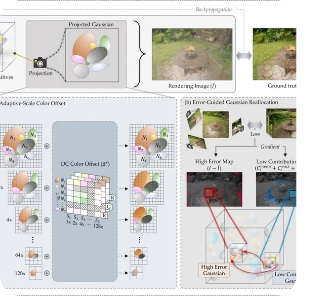
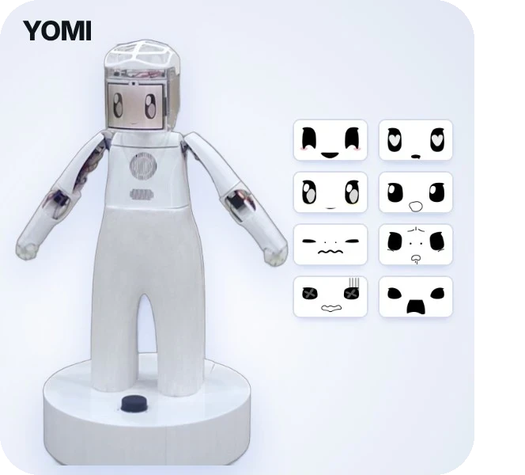

<h2>Hyeonbin Park 박현빈</h2>

M.S. student at [ISPL](https://dauispl.quv.kr/), Dong-A University (advisor: Prof. Dongsan Jun). I work on **multi-scale rendering** and **artifact reduction** for 3D Gaussian Splatting, and also study video coding (VVC, HEVC). 
동아대학교 영상신호처리연구실 석사과정 · 3D Gaussian Splatting의 다중 스케일 렌더링과 아티팩트 저감을 연구합니다.

[Homepage](https://hyeonbinpark1206.github.io) · [Email](mailto:hbpark@donga-ispl.kr)

### Publications

<!-- PUBS:START -->

<b>Adaptive-Scale Color Offset and Error-Guided Gaussian Reallocation for Multi-Scale 3D Gaussian Splatting</b> 
<b>Hyeonbin Park</b>*, Yooho Lee*, Dongho Lee, Dongsan Jun &nbsp;(* equal contribution) 
<i>Mathematics</i>, 2026 · <a href="https://www.mdpi.com/2227-7390/14/15/2713">Paper</a> 
Scale-specific color offsets and error-guided reallocation of low-contribution Gaussians improve coarse-scale rendering without changing the renderer.

 
<!-- PUBS:END -->

### Projects

<!-- PROJECTS:START -->

<b><a href="https://hyeonbinpark1206.github.io/YOMI/">YOMI — Humanoid Robot for Pre-service Kindergarten Teachers</a></b> 
Undergraduate capstone · 2025 · Team lead · <a href="https://hyeonbinpark1206.github.io/YOMI/">Project Page</a> · <a href="https://github.com/HyeonbinPark1206/4IU_RobotAI">Code</a> 
STT · LLM · TTS · vision · touch · motors on one Jetson Orin NX. I built the real-time Korean STT and the ROS integration core.

<small><small>Awards &amp; Patent</small></small>

<b>Silver</b> (1st author) · <b>Bronze</b> ×2 — KDCS 2025 Paper Competition 
<b>Excellence Award</b> — Dong-A University FairDay 2025 
<b>Technology Award</b> — BDIA Side Project Exhibition 2025 
<b>Encouragement Award</b> — National Univ. SW Forum 2025 
<b>Patent application</b> — KR 10-2025-0184890

 
<!-- PROJECTS:END -->
